# code-rain: animated dark theme for Claude Code

<p align="center">
  
</p>

A **dark theme for developers** using [Claude Code](https://claude.com/claude-code):
syntax-highlighted code (Java, HTML, PHP, SQL, JavaScript/Vue, Scala, C, Bash) rains
down the sides of the **Claude desktop app**, in VS Code Dark+ colors, while the
middle of the window stays clear for reading. In the **terminal (CLI)**, the same code
rain plays in a pane you open with `/code-rain`.

*[Version française plus bas](#version-française).*

| Where | What the mod does |
| --- | --- |
| **Desktop / mobile app** | Very dark theme + animated code-rain background on both sides of the window. The rain falls when the app's hardware acceleration is on; otherwise the app freezes the background (see [Frozen rain](#frozen-rain-on-desktop)). |
| **Terminal (CLI)** | The terminal draws no theme or background: type `/code-rain` to show (or hide) the rain in an animated pane. |

## Install

In a Claude Code terminal session:

```
/plugin install code-rain --marketplace Paul-Tardieu/claude-code-rain
```

Answer `y` to add the marketplace, then pick the scope (user by default). The theme
is active right away.

From a shell:

```bash
claude plugin install code-rain --marketplace Paul-Tardieu/claude-code-rain
```

In the desktop app (where `/plugin` does not work): click **+** next to the prompt
box, then **Plugins**, **Add marketplace** with `Paul-Tardieu/claude-code-rain`, then
**Add plugin**.

## Frozen rain on desktop

When the desktop app runs without hardware acceleration (software rendering), it
stops every background animation on purpose, so the rain shows still. To see it fall,
uncheck **Disable Hardware Acceleration** in the app menu (or set
`"isHardwareAccelerationDisabled": false` in `~/.config/Claude/claude_desktop_config.json`)
and restart the app. If the app turned acceleration off by itself after GPU crashes
(`[gpu-recovery]` lines in `~/.config/Claude/logs/main.log`), turning it back on may
crash the app at startup: set the value back to `true` to undo.

## Customize

The SVG scene, the code snippets and `docs/preview.svg` are generated by
`gen_scene.py`:

```bash
python3 gen_scene.py > hooks/scene.js
```

Edit `SNIPPETS` (the code that falls), `lanes` (position, size and opacity of each
column) or the `fade` gradient (width of the clear middle area). The terminal rain's
speed is set in `hooks/rain.ts` (`speed`) and `hooks/register.tsx` (`FRAME_MS`).

---

## Version française

Un mod pour Claude Code : une **pluie de code coloré façon IDE** (Java, HTML, PHP,
SQL, JS, Scala, C, Bash) avec la coloration d'un thème sombre classique.

| Où | Ce que fait le mod |
| --- | --- |
| **App desktop / mobile** | Thème très sombre + fond de pluie de code sur les côtés de la fenêtre, le centre reste dégagé pour la lecture. La pluie tombe quand l'accélération matérielle de l'app est active ; sinon l'app fige le fond (voir [Pluie immobile](#pluie-immobile-sur-desktop)). |
| **Terminal (CLI)** | Le terminal ne dessine ni thème ni fond : tapez `/code-rain` pour afficher (ou masquer) la pluie dans un panneau animé. |

Chacun prend ce qu'il veut : rien ne s'affiche dans le terminal tant que vous ne
lancez pas `/code-rain`.

### Installation

Dans une session Claude Code en terminal :

```
/plugin install code-rain --marketplace Paul-Tardieu/claude-code-rain
```

Répondez `y` pour ajouter le marketplace, puis choisissez la portée (utilisateur par
défaut). Le mod est actif tout de suite.

Depuis un shell :

```bash
claude plugin install code-rain --marketplace Paul-Tardieu/claude-code-rain
```

Dans l'app desktop (où `/plugin` ne fonctionne pas) : cliquez sur **+** à côté de la
zone de saisie, puis **Plugins**, **Add marketplace** avec
`Paul-Tardieu/claude-code-rain`, puis **Add plugin**.

### Pluie immobile sur desktop

Quand l'app desktop tourne sans accélération matérielle (rendu logiciel), elle coupe
volontairement toute animation des fonds : elle ajoute `animation:none!important` au
SVG et en retire les balises SMIL. Le mod n'y peut rien ; la pluie s'affiche alors
immobile, chaque bloc à une position de départ répartie.

Pour la voir tomber, réactivez l'accélération : décochez **Disable Hardware
Acceleration** dans le menu de l'app (ou mettez `"isHardwareAccelerationDisabled": false`
dans `~/.config/Claude/claude_desktop_config.json`), puis redémarrez l'app.

Attention : l'app désactive parfois l'accélération d'elle-même après des plantages du
processus GPU (`isHardwareAccelerationAutoDisabled: true`, lignes `[gpu-recovery]` dans
`~/.config/Claude/logs/main.log`). Dans ce cas, la réactiver peut faire planter l'app au
démarrage ; remettez la valeur à `true` pour revenir en arrière.

### Personnaliser

La scène SVG, les extraits de code et l'aperçu `docs/preview.svg` sont générés par
`gen_scene.py` :

```bash
python3 gen_scene.py > hooks/scene.js
```

Modifiez `SNIPPETS` (le code qui tombe), `lanes` (position, taille, opacité des
colonnes) ou le dégradé `fade` (largeur de la zone dégagée au centre). La vitesse de
la pluie du terminal se règle dans `hooks/rain.ts` (`speed`) et `hooks/register.tsx`
(`FRAME_MS`).

### Fichiers

- `hooks/register.tsx` : le mod (thème, fond, commande `/code-rain`, panneau terminal)
- `hooks/rain.ts` : l'animation du terminal (cellules d'un `Raster`)
- `hooks/scene.js` : scène SVG + flux de caractères, générés
- `hooks/make-colors.js` : générateur de palette fourni par Claude Code
- `docs/preview.svg` : aperçu animé du README, généré
